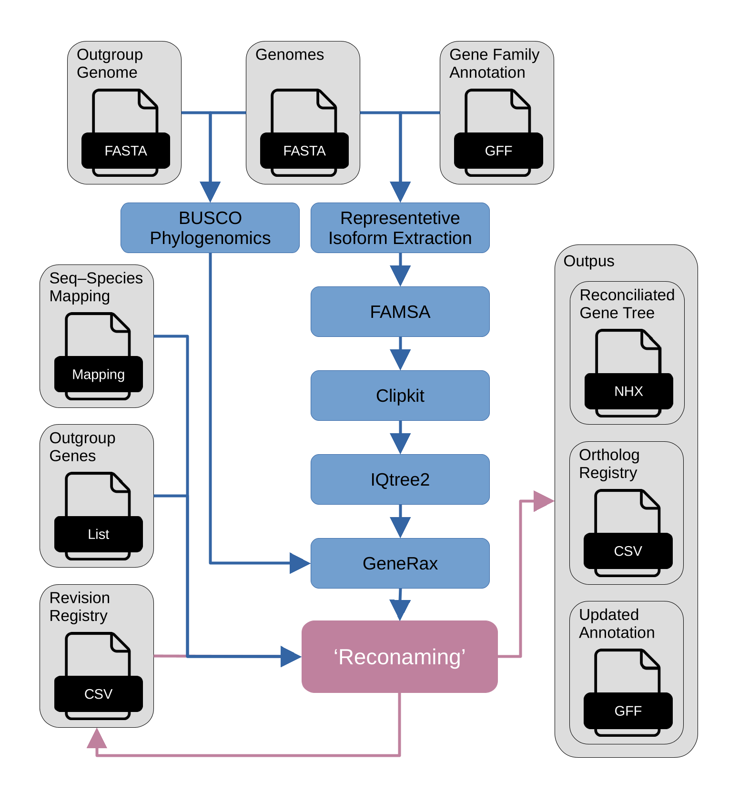

# Reconaming

Reconaming (**Recon**ciliated **naming**) is an ortholog-aware multigene-family reconciliation and naming pipeline. Starting from either gene annotations and genomic sequences or a prepared protein set, it infers or validates a species tree, infers and reconciles a gene tree, and assigns consistent ortholog-aware gene names. A revision registry carries forward unambiguous historical orthology group assignments between annotation or dataset revisions.



## Contents
...

## Installation and prerequisites

### Software requirements

- [Nextflow](https://www.nextflow.io/)
- Java, as required by the installed Nextflow release
- Either Docker or Apptainer/Singularity to run the configured containers

The workflow currently uses Nextflow's `local` executor by default. Docker and Singularity/Apptainer profiles are provided. Scheduler-based HPC execution is described as experimental below.

### Obtain Reconaming

```bash
git clone https://github.com/scie-mon/Reconaming.git
cd Reconaming
```

### Container runtime

Use one of the supplied profiles:

```bash
# Docker
nextflow run main.nf -profile docker [options]

# Apptainer/Singularity
nextflow run main.nf -profile singularity [options]
```

The four container build recipes are supplied in the repository:

- Species-tree inference: `containers/Dockerfile.species-tree`
- Gene-tree inference: `containers/Dockerfile.gene-tree`
- GeneRax reconciliation: `containers/Dockerfile.generax`
- Reconaming core: `containers/Dockerfile.reconaming-core`

Prebuilt Reconaming images are not currently published. The profiles do not build images automatically: before running the pipeline, build or otherwise provide the required images under the names configured for the workflow. The Dockerfiles are recipes, not images that Apptainer/Singularity can run directly; building them on a system without Docker requires a suitable container-build facility.

### Run the bundled test dataset

The repository includes small integration-test datasets under `test/`, including a species-tree-inference case in `test/spec_tree/` and supplied-species-tree cases in `test/provide_spec_tree/`. These datasets include test genome FASTA files, a GFF3, a species-input table, and—where relevant—outgroup genes or a supplied species tree.

The following is the intended smoke-test pattern. Run it in a new output directory after setting process_cpus in nextflow.config:

```bash
nextflow run main.nf \
  -profile docker \
  --sequence_inputs test/spec_tree/test_species_tree_inputs.tsv \
  --annotation test/spec_tree/merged.rev0.gff3 \
  --outgroup_genes test/spec_tree/outgroup_genes.txt \
  --revision_tag test_rev_001 \
  --outdir results_test
```

## Quick start

For a standard analysis that starts from genome FASTA files and annotations, run:

```bash
nextflow run main.nf \
  -profile docker \
  --sequence_inputs path/to/sequence_inputs.tsv \
  --annotation 'path/to/annotations/*.gff3' \
  --revision_tag rev_001 \
  --outdir results \
  -resume
```

Replace the placeholder paths. `--revision_tag` is required. Use `-resume` when repeating or restarting a run with unchanged inputs and configuration; it lets Nextflow reuse valid completed tasks retained in the work directory.

A protein-route run, using pre-extracted representative proteins, has the following form:

```bash
nextflow run main.nf \
  -profile docker \
  --protein_fasta path/to/representative_proteins.faa \
  --id_species path/to/gene_to_species.tsv \
  --species_tree path/to/species_tree.nwk \
  --revision_tag rev_001 \
  --outdir results \
  -resume
```

## Input routes

Reconaming has two input routes. Both converge on protein alignment, gene-tree inference, reconciliation, and naming.

### Annotation route

Annotation mode is selected automatically when `--annotation` is supplied and `--sequence_inputs` contains focal genome inputs. All focal inputs used for annotation preparation must have `input_type=genome`. There is no explicit mode selector.

Required inputs:

| Parameter | Description |
|---|---|
| `--sequence_inputs` | Tab-separated sequence-input table identifying focal species and their genome FASTA files |
| `--annotation` | annotation GFF/GFF3 file or path/glob resolving to the annotation file(s) |
| `--revision_tag` | Identifier for this naming revision round |

The pipeline prepares proteins from the annotations, builds an input manifest, and selects one representative isoform per gene. Supply `--selection_table` when manual representative-isoform choices are required. Without it, the pipeline applies its automatic representative-selection procedure; if a required manual selection remains unresolved, the run stops and writes material for completion under the output directory.

### Protein route

Protein mode is selected automatically when both `--protein_fasta` and `--id_species` are supplied.

Required inputs:

| Parameter | Description |
|---|---|
| `--protein_fasta` | Protein FASTA containing the representative sequences to analyse |
| `--id_species` | Gene-ID-to-species-ID mapping file corresponding to the protein FASTA |
| `--revision_tag` | Identifier for this naming revision round |

`--id_species` is a TSV with `sequence_id` and `species_id` columns; sequence IDs must match protein FASTA identifiers. Protein mode validates the supplied proteins and mapping, but does not have source GFF/GFF3 records to rewrite. No GFF output is produced. Omit `--gff_output`; an explicit `--gff_output none` is also accepted. Requests for `update` or `minimal` fail during startup validation.

### Shared optional inputs

| Parameter | Purpose |
|---|---|
| `--species_tree` | Use a supplied species tree instead of inferring one |
| `--species_tree_outgroup` | Outgroup information used when validating or rooting a supplied species tree |
| `--outgroup_genes` | File of gene IDs used for gene-tree rooting; an empty project asset is used when omitted |
| `--revision_registry` | Revision registry from a previous naming round; an empty project registry is used for a first round |
| `--reconaming_opt` | Path to the advanced Reconaming-core control file; defaults to `conf/reconaming_opt.ctl` |
| `--outdir` | Destination for final results; defaults to `results` |
| `--sequence_inputs` (protein route) | In protein route this can be also used to configure the species tree inference input |

Analysis-input selection and species-tree selection are independent.

| Analysis route | Complete required input set |
|---|---|
| Annotation | `--annotation` + focal genomes in `--sequence_inputs` |
| Protein | `--protein_fasta` + `--id_species` |

Exactly one analysis input set must be complete. If neither or both are complete, startup validation stops the run. Incomplete alternative input sets do not select another route.

Species-tree selection uses the following precedence:

A species tree supplied through `--species_tree` takes precedence over internal inference. The pipeline validates the supplied tree before using it; validation failure stops the run rather than triggering inference.

When no species tree is supplied, the pipeline infers one from suitable focal-species and auxiliary-outgroup inputs listed in --sequence_inputs. If the required inference inputs are missing or incomplete, the run stops with an error identifying the missing prerequisites.

`--sequence_inputs` is a TSV with these columns:

| Column | Meaning |
|---|---|
| `species_id` | Species identifier |
| `input_file` | Genome or proteome FASTA path, accessible from the run directory |
| `input_type` | `genome` or `proteome` |
| `role` | `focal` or `outgroup` |

For inference, supply one input for every analysed focal species and exactly one auxiliary outgroup. Species identifiers must be unique, the focal set must match the representative-protein manifest exactly, and the auxiliary outgroup must not be a gene-family species. With `--busco_mode auto`, each row's `input_type` is used; genome, proteome and mixed inputs are supported. Here, `auto` follows the table rather than detecting sequence type. The inference workflow roots on the auxiliary outgroup and then prunes it.

The per-species proteomes used for species-tree inference are separate from the representative gene-family `--protein_fasta`. Protein mode can therefore infer a species tree when the required per-species sequence inputs are supplied.

Annotation preparation still requires focal genomes. If a tree is supplied, auxiliary inference rows are not required or used; a table containing them is not a route conflict. Protein mode with a supplied tree does not need `--sequence_inputs`, and an unused sequence table is not read unless annotation inputs also need evaluation.

## Parameters

Set pipeline parameters in the params block of nextflow.config. It is the authoritative source of defaults; main.nf uses and validates them. Command-line --name value and native Nextflow parameter files are optional overrides. Core-only naming options are separate in conf/reconaming_opt.ctl.

### Core run parameters

| Parameter | Default | Meaning |
|---|---:|---|
| `--outdir` | `results` | Final-results directory |
| `--revision_tag` | none; required | Name for the current revision round, for example `rev_001` |
| `--revision_registry` | empty project registry | Previous revision registry to continue from |
| `--gff_output` | unset (`null`) | Route-specific default: `update` for annotation, `none` for protein. Annotation accepts `update`, `minimal`, or `none`; protein accepts only omission or `none` |

### Annotation and protein inputs

| Parameter | Default | Meaning |
|---|---:|---|
| `--sequence_inputs` | none | Species-labelled genome/proteome table; focal genomes prepare annotations, while focal + outgroup sequences enable inference |
| `--annotation` | none | annotation GFF/GFF3 for annotation mode |
| `--selection_table` | empty project table | Optional manual representative-isoform selection table |
| `--protein_fasta` | none | Representative protein FASTA for protein mode |
| `--id_species` | none | Gene-to-species mapping for protein mode |
| `--gene_id_attribute` | `ID` | GFF attribute used as the gene identifier |
| `--transcript_id_attribute` | `ID` | GFF attribute used as the transcript identifier |
| `--protein_id_attribute` | empty | Optional GFF attribute used as the protein identifier |

### Species-tree parameters

| Parameter | Default | Meaning |
|---|---:|---|
| `--species_tree` | none | Supplied species tree; skips internal species-tree inference |
| `--species_tree_outgroup` | none | Outgroup for supplied-tree validation/rooting |
| `--busco_lineage` | none | BUSCO lineage dataset used for all species-tree inputs; omitted or blank enables automatic selection independently for each input |
| `--busco_mode` | `auto` | Follow each row's `input_type`; `genome` or `proteome` forces one type for all inference inputs |
| `--busco_warn_complete` | `90` | Completeness threshold that triggers a warning |
| `--species_tree_bootstrap` | `1000` | Number of species-tree bootstrap replicates |

#### BUSCO lineage selection

When `--busco_lineage` is specified with a non-empty value, Reconaming uses that dataset for all species-tree inputs, including every focal species and the auxiliary outgroup. For example, add `--busco_lineage arthropoda_odb12` to the run command to use that dataset throughout the analysis.

When `--busco_lineage` is omitted or blank, BUSCO selects a lineage independently for each input using `--auto-lineage`. Reconaming does not harmonise automatically selected datasets across species. This lineage selection is separate from `--busco_mode auto`, which follows each row's genome/proteome input type.

An invalid explicit lineage causes the run to fail; it does not trigger automatic lineage selection as a fallback. These settings apply only to internal species-tree inference and are not used when `--species_tree` supplies the tree.

#### Species-tree alignment and inference

BUSCO_phylogenomics prepares only the concatenated supermatrix and its partitions (`--supermatrix_only`). IQ-TREE infers the species tree from those outputs. Individual BUSCO marker trees are not generated, so no marker-gene-tree minimum-species threshold is exposed. The workflow then roots the species tree on the auxiliary outgroup and prunes that outgroup.

### Gene-tree and reconciliation parameters

| Parameter | Default | Meaning |
|---|---:|---|
| `--famsa_args` | empty | Additional arguments passed to FAMSA |
| `--iqtree_args` | empty | Additional arguments passed to IQ-TREE |
| `--gene_tree_container` | `reconaming-gene-tree:0.1.0` | Container for the labelled gene-tree process |
| `--generax_rec_model` | `UndatedDL` | GeneRax reconciliation model |
| `--generax_strategy` | `SPR` | GeneRax search strategy |
| `--generax_seed` | `12345` | Random seed for GeneRax |
| `--generax_args` | empty | Additional arguments passed to GeneRax; not MPI launcher options |
| `--generax_oversubscribe` | `true` | Permit the requested MPI ranks to exceed Open MPI's recognised slot count; set to `false` to omit `--oversubscribe` |
| `--generax_container` | `reconaming-generax:2.0.4` | Container for GeneRax reconciliation |

GeneRax runs through MPI with one rank per allocated process CPU (`-np task.cpus`). Configure that allocation through `params.process_cpus.RECONCILE_GENE_TREE`, not a separate GeneRax CPU parameter.

`generax_oversubscribe` defaults to `true`, preserving the existing local/container launch behaviour. It permits ranks beyond Open MPI's recognised slot count; it does not increase the rank count or allocate additional CPUs. Set `generax_oversubscribe = false` in the configuration, or pass `--generax_oversubscribe false`, to omit the flag and retain MPI's normal slot-limit check. The setting must be Boolean, not a quoted configuration string. It is an MPI launch policy, not a GeneRax thread setting.

### Per-process CPU allocation

Set numeric CPU requests in `params.process_cpus` in `nextflow.config`:

```nextflow
process_cpus = [
    PREPARE_PROTEINS:          1,
    RUN_BUSCO:                16,
    RUN_BUSCO_PHYLOGENOMICS:  64,
    INFER_SUPERMATRIX_TREE:   64,
    ALIGN_PROTEINS:           64,
    INFER_GENE_TREE:          64,
    RECONCILE_GENE_TREE:      64
]
iqtree_threads = 'AUTO'
```

These are current 64-CPU development defaults, not release defaults. `RUN_BUSCO=16` permits four independent BUSCO species/outgroup tasks concurrently on 64 CPUs. The aggregate downstream stages receive 64. `PREPARE_PROTEINS` is a single-threaded Python task but runs once per focal species, so it retains one CPU per task.

`iqtree_threads` owns gene-tree IQ-TREE `-T`: use `AUTO` or a positive integer no greater than `process_cpus.INFER_GENE_TREE`. The pipeline always sets `-ntmax` to the effective process allocation. `iqtree_args` remains available for model, bootstrap and other advanced arguments, but must not contain `-T`, `-nt`, `--threads`, `-ntmax` or `--threads-max`.

There is no pipeline hardware detection, CPU Auto mode, launcher, generated configuration or automatic clamping. Run normally:

```bash
nextflow run main.nf -profile docker
```

### Advanced naming configuration

| Parameter | Default | Meaning |
|---|---:|---|
| `--reconaming_opt` | `conf/reconaming_opt.ctl` | Advanced Reconaming-core control file |
| `--reconaming_container` | `reconaming-core:6.2` | Container for the Reconaming core |
| `--outgroup_genes` | empty project file | Gene IDs used to root the reconciled gene tree |

## Revision rounds and revision registry

### Why revisioning exists

Gene-family naming might be required to be repeated as annotations improve, taxa are added, gene models change, or phylogenetic evidence is updated. Reconaming treats each such analysis as a revision round. The goal is to preserve unambiguous historical ParentGroup assignments where possible while allowing names to change when the underlying reconciliation genuinely changes. Deprecated gene numbers are never re-used and stay associated with their gene as an alias. A revision matrix keeps track of this, declaring legacy names of each gene and orthology of all contained genes with the current name set.

### Starting a revision round

Every run must have a `--revision_tag`. Choose a stable, human-readable tag that identifies the round, for example `rev_001`, `rev_002`, or a date-based tag such as `rev_20260924`.

For a first round, omit `--revision_registry`; the workflow starts from the project's empty registry. For a later round, supply the registry produced by the previous accepted round:

```bash
nextflow run main.nf -profile docker \
  --revision_tag rev_002 \
  --revision_registry path/to/rev_001_revision_registry.csv \
  [other input and run parameters]
```

Do not reuse a revision tag for a biologically distinct round. Retain the inputs, configuration, registry, named tree, name table, and report associated with every accepted revision.

### The revision registry

The revision registry records historical ParentGroup assignments. It is an input to a new round and an output from the Reconaming stage. Carrying it forward gives the naming core the information needed to restore unambiguous historical assignments rather than treating each revision as an unrelated naming exercise.

The actual policy is controlled by the Reconaming control file. In particular:

- `minimal_id` defines the lowest numeric ParentGroup identifier for a new empty registry.
- `allow_revive_pg` permits restoration of unambiguous historical ParentGroup assignments.
- `prefix` supplies the optional gene-family label embedded in generated names.
- `aliases` provides species-to-alias mappings.

### Advanced control file

`conf/reconaming_opt.ctl` is an advanced configuration file for the Reconaming core. Empty values are ignored. It contains options for support thresholds, aliases, outgroup treatment, ParentGroup limits and overrides, rooting, tree ordering, and boundary behaviour.

The control file accepts only naming-core options. Pipeline inputs, outputs, tools and CPU allocations belong in nextflow.config; non-core control-file keys are errors.

## Output

Reconaming writes final, user-facing outputs under `--outdir` (default: `results`). Exact filenames and subdirectory names are part of the pipeline version and should be recorded with the run.

### Primary outputs

The Reconaming stage produces the material needed to interpret and continue a naming round:

- A named reconciled gene tree
- A gene-name table
- An updated revision registry for a subsequent revision round
- A Reconaming report
- A temporary partition artifact used by post-processing

### Annotation-mode outputs

In annotation mode, omitting `--gff_output` defaults to `update`. With `update`, post-processing applies Reconaming results to the supplied annotation data. `--gff_output minimal` requests a reduced annotation-oriented output, while `--gff_output none` suppresses GFF/GFF3 output.

### Protein-mode outputs

Protein mode produces the naming outputs but has no source GFF/GFF3 records to update, so it never produces GFF output. No `--gff_output` setting is required; explicit `none` is accepted, while `update` and `minimal` are rejected during startup validation.

### Run state and intermediate files

The Nextflow `work/` directory and `.nextflow/` contain execution state, staged inputs, logs, task scripts, caches, and intermediates. Remove them only after deciding that the associated run no longer needs to be resumed.

If reports, traces, or timelines are enabled for a run, treat them as execution diagnostics. They are useful for troubleshooting and provenance, but they are distinct from the final named tree, name table, revision registry, and annotation outputs.

## HPC and container configuration

Scheduler-based HPC/cluster execution is not currently developed or validated. The checked-in configuration uses Nextflow's local executor and provides Docker and Singularity/Apptainer profiles; these container profiles are not scheduler profiles. No scheduler or multi-node MPI support is claimed.

Resource requests remain separate from the reconciliation command: `params.process_cpus.RECONCILE_GENE_TREE` sets the task CPU allocation, and GeneRax's MPI rank count follows `task.cpus`. The `generax_oversubscribe` switch allows the current launcher flag to be disabled without editing the process module. These configuration points leave room for future site-specific execution; they do not establish HPC compatibility.

Future HPC deployment will require site-specific executor, memory, walltime, filesystem and container configuration, plus validation of MPI launching and CPU placement. That work is outside the current development scope.

## License

Reconaming is distributed under the GNU General Public License v3.0. See [`LICENSE`](LICENSE).

## Citation

Citation metadata is provided in [`CITATION.cff`](CITATION.cff). Please cite the software using that file and cite the underlying methods and software used by your analysis where appropriate.
