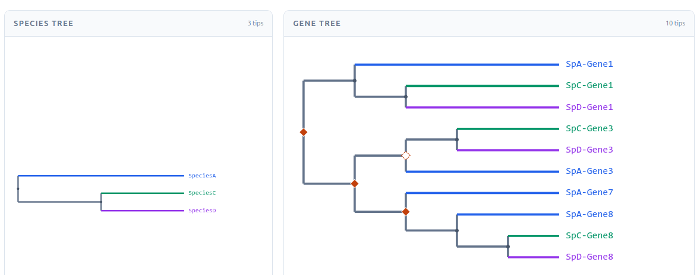

# Reconaming

Reconaming (**Recon**ciliated **naming**) is an ortholog-aware multigene-family reconciliation and naming pipeline. Starting from either gene annotations and genomic sequences or a prepared protein set, it infers or validates a species tree, infers and reconciles a gene tree, and assigns consistent ortholog-aware gene names. A revision registry carries forward unambiguous historical orthology group assignments between annotation or dataset revisions.

For the biological rationale and an interactive walkthrough, see [How Reconaming works](#how-reconaming-works). To run an analysis, continue with installation and [Quick start](#quick-start).


## Contents

- [Installation and prerequisites](#installation-and-prerequisites)
- [Quick start](#quick-start)
- [How Reconaming works](#how-reconaming-works)
  - [Explore the naming principle](#explore-the-naming-principle)
  - [Gene identities, orthology and naming groups](#gene-identities-orthology-and-naming-groups)
  - [ParentGroups and nested relationships](#parentgroups-and-nested-relationships)
  - [Boundaries and uncertain relationships](#boundaries-and-uncertain-relationships)
  - [How to read a generated name](#how-to-read-a-generated-name)
- [Input routes](#input-routes)
- [Parameters](#parameters)
- [Revision rounds and revision registry](#revision-rounds-and-revision-registry)
  - [Why revisioning exists](#why-revisioning-exists)
  - [Starting a revision round](#starting-a-revision-round)
  - [The revision registry](#the-revision-registry)
  - [Advanced control file](#advanced-control-file)
- [Output](#output)
- [HPC and container configuration](#hpc-and-container-configuration)
- [License](#license)
- [Citation](#citation)

## Installation and prerequisites

### Software requirements

- [Nextflow](https://www.nextflow.io/)
- Java, as required by the installed Nextflow release
- Either Docker or Apptainer/Singularity to run the configured containers

The workflow currently uses Nextflow's `local` executor by default. Docker and Singularity/Apptainer profiles are provided. Scheduler-based HPC execution is described as experimental below.

### Obtain Reconaming

```bash
git clone https://github.com/scie-mon/Reconaming.git
cd Reconaming
```

### Container runtime

Use one of the supplied profiles:

```bash
# Docker
nextflow run main.nf -profile docker [options]

# Apptainer/Singularity
nextflow run main.nf -profile singularity [options]
```

The four container build recipes are supplied in the repository:

- Species-tree inference: `containers/Dockerfile.species-tree`
- Gene-tree inference: `containers/Dockerfile.gene-tree`
- GeneRax reconciliation: `containers/Dockerfile.generax`
- Reconaming core: `containers/Dockerfile.reconaming-core`

Prebuilt Reconaming images are not currently published. The profiles do not build images automatically: before running the pipeline, build or otherwise provide the required images under the names configured for the workflow. The Dockerfiles are recipes, not images that Apptainer/Singularity can run directly; building them on a system without Docker requires a suitable container-build facility.

### Run the bundled test dataset

The repository includes small integration-test datasets under `test/`, including a species-tree-inference case in `test/spec_tree/` and supplied-species-tree cases in `test/provide_spec_tree/`. These datasets include test genome FASTA files, a GFF3, a species-input table, and—where relevant—outgroup genes or a supplied species tree.

The following is the intended smoke-test pattern. Run it in a new output directory after setting process_cpus in nextflow.config:

```bash
nextflow run main.nf \
  -profile docker \
  --sequence_inputs test/spec_tree/test_species_tree_inputs.tsv \
  --annotation test/spec_tree/merged.rev0.gff3 \
  --outgroup_genes test/spec_tree/outgroup_genes.txt \
  --revision_tag test_rev_001 \
  --outdir results_test
```

## Quick start

For a standard analysis that starts from genome FASTA files and annotations, run:

```bash
nextflow run main.nf \
  -profile docker \
  --sequence_inputs path/to/sequence_inputs.tsv \
  --annotation 'path/to/annotations/*.gff3' \
  --revision_tag rev_001 \
  --outdir results \
  -resume
```

Replace the placeholder paths. `--revision_tag` is required. Use `-resume` when repeating or restarting a run with unchanged inputs and configuration; it lets Nextflow reuse valid completed tasks retained in the work directory.

A protein-route run, using pre-extracted representative proteins, has the following form:

```bash
nextflow run main.nf \
  -profile docker \
  --protein_fasta path/to/representative_proteins.faa \
  --id_species path/to/gene_to_species.tsv \
  --species_tree path/to/species_tree.nwk \
  --revision_tag rev_001 \
  --outdir results \
  -resume
```

## How Reconaming works

### Explore the naming principle

[Open the interactive example: from gene-family evolution to naming](https://scie-mon.github.io/Reconaming/assets/gene_family_evolution_example.html).

[](https://scie-mon.github.io/Reconaming/assets/gene_family_evolution_example.html)

Follow a fictional multigene family through speciation, duplication and gene loss. Paired species and gene trees show why orthology alone does not provide the gene-identity distinction that Reconaming's names are intended to convey, and how ParentGroups and naming-group suffixes provide a practical compromise.

Choose between the alternative evolutionary paths, then follow the expanded family to its final naming example. The diagrams show topology, not elapsed time or substitution distances. JavaScript is required to explore the alternative paths.

> The example begins with a known fictional history. Real analyses must infer that history from surviving data, and some events may remain unresolved or undetectable. The example is an explanation of the naming principle, not a pipeline run, validation dataset or demonstration of revision-registry operation.

The sections below summarise the principle without requiring the interactive page. Installation and execution instructions remain separate from this biological explanation.

### Gene identities, orthology and naming groups

For a pair of homologous genes, orthology describes a relationship arising through speciation; paralogy describes one arising through duplication. In a simple one-to-one case, orthology corresponds to the intuitive idea of the same gene in different species. But orthology also includes one-to-many relationships after later duplications.

For example, a gene retained in one species can be orthologous to both copies produced by a later duplication in another species. Those two copies are nevertheless distinct genes and paralogs of each other. A useful naming scheme should preserve the distinction between the corresponding gene identity across species and the broader orthology relationship to later duplicates.

Reconaming derives this distinction from a reconciled gene tree. Reconciliation relates the gene tree to the species tree and annotates duplication events. The naming stage reads that inferred history rather than independently reconstructing another evolutionary tree.

Reconaming assigns genes to naming groups using this tree. A shared assignment extends along branches until a naming boundary is reached; separate groups are assigned beyond that boundary. The boundary-delimited groups form the orthology-group partition used for naming, referred to here as orthogroups or naming groups. Genes in different naming groups can still be orthologous, particularly when duplications create nested relationships. Naming-group membership is therefore not a substitute for inspecting the full evolutionary relationship.

Here, inferred gene identity means the correspondence that the naming scheme seeks to preserve across species. It does not mean identical sequences, interchangeable function or independent proof that the inferred history is correct.

### ParentGroups and nested relationships

Independent numbers could distinguish all naming groups, but would say nothing about their broader ancestry. Encoding every successive duplication as another identifier level would preserve more detail, but would produce increasingly cumbersome names.

Reconaming uses a practical compromise: one broader ancestral naming level, called a ParentGroup, plus a suffix distinguishing the naming groups within it. Each ParentGroup represents an ancestral gene lineage within the evolutionary scope included in the analysis and contains the descendants of its root, including later duplicates.

In the simplified, duplication-based explanation, ParentGroup roots are identified by traversing the tree from root to tips and locating the first non-duplication nodes encountered along the lineages within the selected input scope. In the implementation, these roots must also satisfy the active naming-boundary rules and any ParentGroup restrictions or overrides. A subtree already assigned to a ParentGroup does not automatically open another ParentGroup at each nested duplication.

The scope is established by the evolutionary history represented in the input; this does not imply a separate option for selecting an arbitrary ancestral reference node inside an unchanged tree. In the interactive example, several gene lineages have already separated by duplication before the first speciation and define separate ParentGroups. If the input instead included an older speciation preceding those duplications, the lineages shown could fall within a single broader ParentGroup. Widening the input does not automatically merge groups: the included history and active boundary rules determine the result.

#### The Gene8 example

In the interactive history, Gene8 duplicates in SpeciesC, producing Gene9 and Gene10. SpeciesC subsequently splits into SpeciesG and SpeciesH. The remaining Gene8 copies in SpeciesA, SpeciesE and SpeciesF retain the narrower Gene8 identity; the Gene9 and Gene10 descendants have distinct identities, although all belong to the broader ancestral Gene8 lineage.

The final naming illustration represents these relationships as follows:

| Gene lineage in the example | Species carrying the illustrated copies | Naming label after grouping |
|---|---|---|
| Remaining Gene8 copies | SpeciesA, SpeciesE, SpeciesF | `Gene8-1` |
| Gene9 descendants | SpeciesG, SpeciesH | `Gene8-2` |
| Gene10 descendants | SpeciesG, SpeciesH | `Gene8-3` |

The shared leading number identifies the ParentGroup; the suffix distinguishes the narrower naming groups. Ignoring the species prefix, the same complete label denotes the same inferred gene identity across species.

Different suffixes do not automatically mean paralogy. A Gene8-1 copy remains orthologous to copies in both other groups, while the Gene8-2 and Gene8-3 lineages are separated by the duplication that produced Gene9 and Gene10. Further nested duplications can create additional naming groups, but the identifier does not encode the complete duplication hierarchy. Use the reconciled tree for that detail.

The numbers in this fictional example were chosen to explain the relationship. They do not promise the exact numbers that a fresh pipeline run would allocate. Actual identifiers also depend on the current partition, traversal and historical assignments in the supplied registry.

### Boundaries and uncertain relationships

The interactive example first uses duplication nodes as naming boundaries: a shared identity continues along speciation branches, while new identities are distinguished across duplications.

Real reconstructed trees can also contain uncertain branching relationships. Reconaming extends the boundary logic to insufficiently supported non-duplication nodes. Instead of asserting that a duplication occurred, such a boundary withholds a shared naming assignment because the connection is too uncertain.

These two boundary types have different meanings:

- A duplication boundary separates gene identities on the basis of the inferred evolutionary history.
- A support-based boundary separates naming assignments conservatively; it is not evidence of a duplication or proof of paralogy.

The core treats an internal node as an automatic boundary if it is labelled as a duplication (`D=Y`), or if its numeric support is below the configured threshold or cannot be recognised. The default threshold is `70`.

By default, `ignore_sco=true` suppresses automatic boundaries in subtrees with no repeated species assignments after species-alias mapping. This exception applies to both duplication-based and support-based candidates. Explicit boundary overrides take precedence. These implementation settings are described under [Advanced control file](#advanced-control-file).

#### Known history versus inferred history

The reciprocal-loss sequence in the interactive example illustrates a separate limitation: a real duplication can be hidden by later losses. In the constructed history, SpB-Gene5 and SpA-Gene6 are paralogs, but their surviving topology alone does not distinguish that history from speciation. The example then deliberately continues under the interpretation that misses the duplication and relabels the surviving copies Gene3.

That relabelling is a change in interpretation, not an additional evolutionary event. The hollow duplication marker preserves the reader's knowledge of the fictional history; it is not information assumed to be available to the naming procedure. Naming follows the inferred history and cannot by itself recover an event for which the necessary distinguishing evidence is absent.

### How to read a generated name

Displayed names have this structure:

```text
<species alias><family prefix><ParentGroup>[-<naming-group number>]
```

The within-ParentGroup naming-group number is called `ParaNr` internally. Despite that technical name, different values alone do not establish paralogy.

The `aliases` mapping supplies species aliases; without a mapping, the species identifier is used. The `prefix` setting supplies the family label or separator. No additional separator is inserted automatically. When `prefix` is unset, the core default is `_`.

For example, with species alias `SpA-`, prefix `Gene`, ParentGroup `8` and subgroup `1`, the displayed name is `SpA-Gene8-1`. The tutorial's shortened labels such as `Gene8-1` omit the species prefix when discussing group relationships.

By default, the displayed `-1` suffix is omitted when every current member of the ParentGroup has `ParaNr=1`. Set `show_single_para=true` to retain it. A sole remaining subgroup numbered `2` or higher still retains its suffix. The revision registry always stores an explicit `ParentGroup-ParaNr` assignment, such as `8-1`, irrespective of display shortening.

The original input identifier remains the stable key linking a gene to its assigned name. The generated name can change as evidence or grouping changes. [Revision rounds and revision registry](#revision-rounds-and-revision-registry) explains how those historical assignments are preserved.

## Input routes

Reconaming has two input routes. Both converge on protein alignment, gene-tree inference, reconciliation, and naming.

### Annotation route

Annotation mode is selected automatically when `--annotation` is supplied and `--sequence_inputs` contains focal genome inputs. All focal inputs used for annotation preparation must have `input_type=genome`. There is no explicit mode selector.

Required inputs:

| Parameter | Description |
|---|---|
| `--sequence_inputs` | Tab-separated sequence-input table identifying focal species and their genome FASTA files |
| `--annotation` | annotation GFF/GFF3 file or path/glob resolving to the annotation file(s) |
| `--revision_tag` | Identifier for this naming revision round |

The pipeline prepares proteins from the annotations, builds an input manifest, and selects one representative isoform per gene. Supply `--selection_table` when manual representative-isoform choices are required. Without it, the pipeline applies its automatic representative-selection procedure; if a required manual selection remains unresolved, the run stops and writes material for completion under the output directory.

### Protein route

Protein mode is selected automatically when both `--protein_fasta` and `--id_species` are supplied.

Required inputs:

| Parameter | Description |
|---|---|
| `--protein_fasta` | Protein FASTA containing the representative sequences to analyse |
| `--id_species` | Gene-ID-to-species-ID mapping file corresponding to the protein FASTA |
| `--revision_tag` | Identifier for this naming revision round |

`--id_species` is a TSV with `sequence_id` and `species_id` columns; sequence IDs must match protein FASTA identifiers. Protein mode validates the supplied proteins and mapping, but does not have source GFF/GFF3 records to rewrite. No GFF output is produced. Omit `--gff_output`; an explicit `--gff_output none` is also accepted. Requests for `update` or `minimal` fail during startup validation.

### Shared optional inputs

| Parameter | Purpose |
|---|---|
| `--species_tree` | Use a supplied species tree instead of inferring one |
| `--species_tree_outgroup` | Outgroup information used when validating or rooting a supplied species tree |
| `--outgroup_genes` | File of gene IDs used for gene-tree rooting; an empty project asset is used when omitted |
| `--revision_registry` | Revision registry from a previous naming round; omission starts a new registry |
| `--reconaming_opt` | Path to the advanced Reconaming-core control file; defaults to `conf/reconaming_opt.ctl` |
| `--outdir` | Destination for final results; defaults to `results` |
| `--sequence_inputs` (protein route) | In protein route this can be also used to configure the species tree inference input |

Analysis-input selection and species-tree selection are independent.

| Analysis route | Complete required input set |
|---|---|
| Annotation | `--annotation` + focal genomes in `--sequence_inputs` |
| Protein | `--protein_fasta` + `--id_species` |

Exactly one analysis input set must be complete. If neither or both are complete, startup validation stops the run. Incomplete alternative input sets do not select another route.

Species-tree selection uses the following precedence:

A species tree supplied through `--species_tree` takes precedence over internal inference. The pipeline validates the supplied tree before using it; validation failure stops the run rather than triggering inference.

When no species tree is supplied, the pipeline infers one from suitable focal-species and auxiliary-outgroup inputs listed in --sequence_inputs. If the required inference inputs are missing or incomplete, the run stops with an error identifying the missing prerequisites.

`--sequence_inputs` is a TSV with these columns:

| Column | Meaning |
|---|---|
| `species_id` | Species identifier |
| `input_file` | Genome or proteome FASTA path, accessible from the run directory |
| `input_type` | `genome` or `proteome` |
| `role` | `focal` or `outgroup` |

For inference, supply one input for every analysed focal species and exactly one auxiliary outgroup. Species identifiers must be unique, the focal set must match the representative-protein manifest exactly, and the auxiliary outgroup must not be a gene-family species. With `--busco_mode auto`, each row's `input_type` is used; genome, proteome and mixed inputs are supported. Here, `auto` follows the table rather than detecting sequence type. The inference workflow roots on the auxiliary outgroup and then prunes it.

The per-species proteomes used for species-tree inference are separate from the representative gene-family `--protein_fasta`. Protein mode can therefore infer a species tree when the required per-species sequence inputs are supplied.

Annotation preparation still requires focal genomes. If a tree is supplied, auxiliary inference rows are not required or used; a table containing them is not a route conflict. Protein mode with a supplied tree does not need `--sequence_inputs`, and an unused sequence table is not read unless annotation inputs also need evaluation.

## Parameters

Set pipeline parameters in the params block of nextflow.config. It is the authoritative source of defaults; main.nf uses and validates them. Command-line --name value and native Nextflow parameter files are optional overrides. Core-only naming options are separate in conf/reconaming_opt.ctl.

### Core run parameters

| Parameter | Default | Meaning |
|---|---:|---|
| `--outdir` | `results` | Final-results directory |
| `--revision_tag` | none; required | Name for the current revision round, for example `rev_001` |
| `--revision_registry` | none; new registry | Previous revision registry to continue from |
| `--gff_output` | unset (`null`) | Route-specific default: `update` for annotation, `none` for protein. Annotation accepts `update`, `minimal`, or `none`; protein accepts only omission or `none` |

### Annotation and protein inputs

| Parameter | Default | Meaning |
|---|---:|---|
| `--sequence_inputs` | none | Species-labelled genome/proteome table; focal genomes prepare annotations, while focal + outgroup sequences enable inference |
| `--annotation` | none | annotation GFF/GFF3 for annotation mode |
| `--selection_table` | empty project table | Optional manual representative-isoform selection table |
| `--protein_fasta` | none | Representative protein FASTA for protein mode |
| `--id_species` | none | Gene-to-species mapping for protein mode |
| `--gene_id_attribute` | `ID` | GFF attribute used as the gene identifier |
| `--transcript_id_attribute` | `ID` | GFF attribute used as the transcript identifier |
| `--protein_id_attribute` | empty | Optional GFF attribute used as the protein identifier |

### Species-tree parameters

| Parameter | Default | Meaning |
|---|---:|---|
| `--species_tree` | none | Supplied species tree; skips internal species-tree inference |
| `--species_tree_outgroup` | none | Outgroup for supplied-tree validation/rooting |
| `--busco_lineage` | none | BUSCO lineage dataset used for all species-tree inputs; omitted or blank enables automatic selection independently for each input |
| `--busco_mode` | `auto` | Follow each row's `input_type`; `genome` or `proteome` forces one type for all inference inputs |
| `--busco_warn_complete` | `90` | Completeness threshold that triggers a warning |
| `--species_tree_bootstrap` | `1000` | Number of species-tree bootstrap replicates |

#### BUSCO lineage selection

When `--busco_lineage` is specified with a non-empty value, Reconaming uses that dataset for all species-tree inputs, including every focal species and the auxiliary outgroup. For example, add `--busco_lineage arthropoda_odb12` to the run command to use that dataset throughout the analysis.

When `--busco_lineage` is omitted or blank, BUSCO selects a lineage independently for each input using `--auto-lineage`. Reconaming does not harmonise automatically selected datasets across species. This lineage selection is separate from `--busco_mode auto`, which follows each row's genome/proteome input type.

An invalid explicit lineage causes the run to fail; it does not trigger automatic lineage selection as a fallback. These settings apply only to internal species-tree inference and are not used when `--species_tree` supplies the tree.

#### Species-tree alignment and inference

BUSCO_phylogenomics prepares only the concatenated supermatrix and its partitions (`--supermatrix_only`). IQ-TREE infers the species tree from those outputs. Individual BUSCO marker trees are not generated, so no marker-gene-tree minimum-species threshold is exposed. The workflow then roots the species tree on the auxiliary outgroup and prunes that outgroup.

### Gene-tree and reconciliation parameters

| Parameter | Default | Meaning |
|---|---:|---|
| `--famsa_args` | empty | Additional arguments passed to FAMSA |
| `--iqtree_args` | empty | Additional arguments passed to IQ-TREE |
| `--gene_tree_container` | `reconaming-gene-tree:0.1.0` | Container for the labelled gene-tree process |
| `--generax_rec_model` | `UndatedDL` | GeneRax reconciliation model |
| `--generax_strategy` | `SPR` | GeneRax search strategy |
| `--generax_seed` | `12345` | Random seed for GeneRax |
| `--generax_args` | empty | Additional arguments passed to GeneRax; not MPI launcher options |
| `--generax_oversubscribe` | `true` | Permit the requested MPI ranks to exceed Open MPI's recognised slot count; set to `false` to omit `--oversubscribe` |
| `--generax_container` | `reconaming-generax:2.0.4` | Container for GeneRax reconciliation |

GeneRax runs through MPI with one rank per allocated process CPU (`-np task.cpus`). Configure that allocation through `params.process_cpus.RECONCILE_GENE_TREE`, not a separate GeneRax CPU parameter.

`generax_oversubscribe` defaults to `true`, preserving the existing local/container launch behaviour. It permits ranks beyond Open MPI's recognised slot count; it does not increase the rank count or allocate additional CPUs. Set `generax_oversubscribe = false` in the configuration, or pass `--generax_oversubscribe false`, to omit the flag and retain MPI's normal slot-limit check. The setting must be Boolean, not a quoted configuration string. It is an MPI launch policy, not a GeneRax thread setting.

### Per-process CPU allocation

Set numeric CPU requests in `params.process_cpus` in `nextflow.config`:

```nextflow
process_cpus = [
    PREPARE_PROTEINS:          1,
    RUN_BUSCO:                16,
    RUN_BUSCO_PHYLOGENOMICS:  64,
    INFER_SUPERMATRIX_TREE:   64,
    ALIGN_PROTEINS:           64,
    INFER_GENE_TREE:          64,
    RECONCILE_GENE_TREE:      64
]
iqtree_threads = 'AUTO'
```

These are current 64-CPU development defaults, not release defaults. `RUN_BUSCO=16` permits four independent BUSCO species/outgroup tasks concurrently on 64 CPUs. The aggregate downstream stages receive 64. `PREPARE_PROTEINS` is a single-threaded Python task but runs once per focal species, so it retains one CPU per task.

`iqtree_threads` owns gene-tree IQ-TREE `-T`: use `AUTO` or a positive integer no greater than `process_cpus.INFER_GENE_TREE`. The pipeline always sets `-ntmax` to the effective process allocation. `iqtree_args` remains available for model, bootstrap and other advanced arguments, but must not contain `-T`, `-nt`, `--threads`, `-ntmax` or `--threads-max`.

There is no pipeline hardware detection, CPU Auto mode, launcher, generated configuration or automatic clamping. Run normally:

```bash
nextflow run main.nf -profile docker
```

### Advanced naming configuration

| Parameter | Default | Meaning |
|---|---:|---|
| `--reconaming_opt` | `conf/reconaming_opt.ctl` | Naming-core options; see [Advanced control file](#advanced-control-file) |
| `--reconaming_container` | `reconaming-core:6.2` | Container for the Reconaming core |
| `--outgroup_genes` | empty project file | Gene IDs used to root the reconciled gene tree |

## Revision rounds and revision registry

### Why revisioning exists

The [interactive example](https://scie-mon.github.io/Reconaming/assets/gene_family_evolution_example.html) explains how a naming partition arises from an evolutionary history. Revisioning addresses a different question: how to preserve historical assignments when a new analysis changes the inputs or the inferred relationships. Evolutionary steps in the example are not software revision rounds, and its illustrative relabelling does not demonstrate registry matching.

Gene-family naming may need to be repeated as annotations improve, taxa are added, gene models change or phylogenetic evidence is updated. Reconaming treats each accepted analysis as a revision round. Historical ParentGroup and within-ParentGroup assignments are retained or restored when their correspondence to the current groups is unambiguous. When the grouping changes incompatibly, new identifiers are assigned rather than forcing previous names onto the new interpretation.

Once assigned, a number remains associated with the gene's recorded naming history, even if its current name changes. Historical numbers are not recycled for unrelated genes; they remain available for restoration when the inferred relationships support an unambiguous historical assignment. Restoration is not reassignment to an unrelated gene. Because these are group identifiers, newly added orthologs can share an existing group assignment without violating this principle.

The registry preserves these historical associations. An old assignment remains a historical alias for the gene even when it is no longer the current assignment. Carry the registry forward between rounds: starting again without it does not preserve numbering continuity. Historical association enables restoration, but does not guarantee automatic restoration in every later round.

### Starting a revision round

Every run must have a `--revision_tag`. Choose a stable, human-readable tag that identifies the round, for example `rev_001`, `rev_002`, or a date-based tag such as `rev_20260924`.

For a first round, omit `--revision_registry`; the core starts a new registry. For a later round, supply the registry produced by the previous accepted round:

```bash
nextflow run main.nf -profile docker \
  --revision_tag rev_002 \
  --revision_registry path/to/revision_registry_rev_001.csv \
  [other input and run parameters]
```

Use a new revision tag for a biologically distinct round. Retain the inputs, configuration, registry, named tree, name table and report associated with every accepted revision.

### The revision registry

The revision registry is a gene-by-revision matrix:

- Rows identify genes by their stable input identifiers.
- Columns represent revision rounds, with the newest revision inserted first.
- Cells record canonical `ParentGroup-ParaNr` assignments, such as `8-1`.
- Historical rows remain even when those genes are absent from the current analysis; their current-revision cells are empty.

The registry is both an input to a new round and an output from the naming stage. It preserves earlier assignments alongside the current naming partition. It does not store complete historical display names, species-alias settings or family-prefix settings, and is not an independently inferred matrix of all pairwise orthology relationships. Retain the corresponding configurations and reconciled trees to interpret those details.

#### Matching and restoring historical assignments

Historical assignments are matched through shared input gene identifiers, not sequence similarity. For an assignment to be reused in the historical revision being evaluated:

- The overlapping genes of the historical group must occur in exactly one current group.
- That current group must not overlap multiple historical groups in that revision.

Membership need not be identical between rounds. Added or removed genes can be compatible with retaining an identifier when shared identifiers establish an unambiguous correspondence. Ambiguous splits or merges do not qualify for reuse from that historical revision.

By default, ParentGroup matching considers historical revisions from oldest to newest. Setting `allow_revive_pg=false` restricts ParentGroup matching to the newest historical column; it does not disable all identifier reuse. Within a retained ParentGroup, subgroup matching considers that ParentGroup's recorded history from oldest to newest.

New numeric ParentGroup identifiers are allocated above the historical numeric range recorded in the supplied registry, including numeric blocks used by legacy identifiers such as `25a`. Within a retained ParentGroup, unmatched subgroups receive numbers above its historical subgroup range.

Stable input identifiers are essential. If an identifier changes, the registry does not automatically recognise the renamed record as the same gene. Conversely, reusing an input identifier for a different gene creates a misleading historical connection.

#### Historical names and aliases

Historical assignments remain associated with each gene through its registry row. They act as aliases in the naming history, but are distinct from aliases explicitly exported in an annotation file.

The `aliases` control-file option maps species identifiers to species aliases used in displayed names; it does not configure historical gene-name aliases. Current GFF post-processing can preserve an existing gene `Name` as `source_name` when replacing it, but does not export the registry's complete history as GFF `Alias` attributes.

Legacy registry identifiers with letter suffixes, such as `25a`, are accepted as complete ParentGroup identifiers, not as a numeric ParentGroup plus a subgroup letter. Bare historical assignments such as `25` or `25a` are interpreted as subgroup `1`; newly written assignments use explicit forms such as `25-1` or `25a-1`. A matching letter-suffixed identifier in the newest historical column can take precedence over a restored numeric identifier with the same numeric prefix.

### Advanced control file

`conf/reconaming_opt.ctl` contains naming-core options. Empty values leave the core defaults in effect. For the biological rationale, see [How Reconaming works](#how-reconaming-works).

| Setting | Purpose |
|---|---|
| `threshold` | Minimum recognised numeric node support for automatic boundary detection; default `70` |
| `ignore_sco` | Suppress automatic boundaries in subtrees with no repeated species assignments after species-alias mapping; default `true` |
| `minimal_id` | Lower bound for fresh numeric ParentGroup assignment; historical numbering can require a higher starting value |
| `allow_revive_pg` | Search older revisions for unambiguous ParentGroup restoration; default `true` |
| `prefix` | Family label or separator used in displayed names; core default `_` |
| `aliases` | Species-to-alias mappings used in displayed names and the single-copy boundary exception |
| `show_single_para` | Retain the displayed `-1` suffix even when all members of a ParentGroup have subgroup number `1`; default `false` |

The control file also accepts outgroup treatment, rooting, tree ordering, ParentGroup size limits, and explicit ParentGroup-root and boundary overrides. Node-based overrides refer to IDs assigned after the core's rooting and sorting steps; these IDs need not remain unchanged when the tree or preprocessing settings change.

The control file accepts only naming-core options. Pipeline inputs, outputs, tools and CPU allocations belong in `nextflow.config`; non-core control-file keys are errors.

#### Support values supplied to the naming core

The support rule operates on numeric internal-node labels in the tree passed to the core. The current GeneRax-output normaliser replaces internal labels matching `n<number>` with `100`. These replacement values are not measured branch-support estimates. Do not interpret the naming threshold as a guarantee that every retained relationship has independently measured support above that threshold.

## Output

Reconaming writes final, user-facing outputs under `--outdir` (default: `results`). Exact filenames and subdirectory names are part of the pipeline version and should be recorded with the run.

### Primary outputs

The Reconaming stage produces the material needed to interpret and continue a naming round:

- A named reconciled gene tree
- A gene-name table linking original input identifiers to current generated names; see [How to read a generated name](#how-to-read-a-generated-name)
- An updated revision registry preserving historical assignments for a subsequent revision round
- A Reconaming report
- A temporary partition artifact used by post-processing

### Annotation-mode outputs

In annotation mode, omitting `--gff_output` defaults to `update`. With `update`, post-processing applies Reconaming results to the supplied annotation data. `--gff_output minimal` requests a reduced annotation-oriented output, while `--gff_output none` suppresses GFF/GFF3 output.

### Protein-mode outputs

Protein mode produces the naming outputs but has no source GFF/GFF3 records to update, so it never produces GFF output. No `--gff_output` setting is required; explicit `none` is accepted, while `update` and `minimal` are rejected during startup validation.

### Run state and intermediate files

The Nextflow `work/` directory and `.nextflow/` contain execution state, staged inputs, logs, task scripts, caches, and intermediates. Remove them only after deciding that the associated run no longer needs to be resumed.

If reports, traces, or timelines are enabled for a run, treat them as execution diagnostics. They are useful for troubleshooting and provenance, but they are distinct from the final named tree, name table, revision registry, and annotation outputs.

## HPC and container configuration

Scheduler-based HPC/cluster execution is not currently developed or validated. The checked-in configuration uses Nextflow's local executor and provides Docker and Singularity/Apptainer profiles; these container profiles are not scheduler profiles. No scheduler or multi-node MPI support is claimed.

Resource requests remain separate from the reconciliation command: `params.process_cpus.RECONCILE_GENE_TREE` sets the task CPU allocation, and GeneRax's MPI rank count follows `task.cpus`. The `generax_oversubscribe` switch allows the current launcher flag to be disabled without editing the process module. These configuration points leave room for future site-specific execution; they do not establish HPC compatibility.

Future HPC deployment will require site-specific executor, memory, walltime, filesystem and container configuration, plus validation of MPI launching and CPU placement. That work is outside the current development scope.

## License

Reconaming is distributed under the GNU General Public License v3.0. See [`LICENSE`](LICENSE).

## Citation

Citation metadata is provided in [`CITATION.cff`](CITATION.cff). Please cite the software using that file and cite the underlying methods and software used by your analysis where appropriate.
